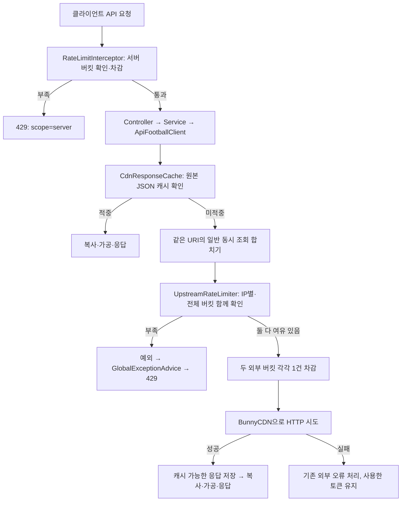

# 두 단계 요청 제한의 구조와 코드 흐름

이 문서는 요청 제한을 왜 나눴는지, 각 클래스가 언제 실행되는지, 캐시·동시 요청·재시도와 어떻게 연결되는지 설명합니다. 제한 적용 대상과 응답 정책은 [요청 제한 정책](rate-limiting.md), IP 식별의 배포 전제는 [클라이언트 IP 설명](client-ip-resolution.md)을 참고하세요.

## 1. 바뀐 문제와 보호 대상

이전에는 `RateLimitInterceptor`가 캐시를 확인하기 전에 모든 API 요청에서 같은 한도를 차감했습니다. 최근·예정 경기 패널을 오가며 캐시된 데이터를 다시 받아도 외부 호출과 동일하게 처리돼, 실제 외부 API 사용량이 늘지 않아도 제한에 도달할 수 있었습니다.

이제 보호할 자원을 나눕니다.

| 단계 | 보호할 자원 | 무엇을 1건으로 세는가 | 버킷 |
| --- | --- | --- | --- |
| 서버 입구 | 백엔드 처리량 | `/api/**`에 들어온 HTTP 요청 | IP별 서버 버킷 |
| 외부 호출 | 외부 HTTP 호출량 | 캐시로 처리되지 않아 실제 실행을 허용한 외부 HTTP 시도 | IP별 외부 버킷 + 전체 외부 버킷 |

**제한 단계는 두 개지만 버킷 종류는 세 개입니다.** 외부 단계에서는 한 사용자의 과도한 조회와 여러 사용자가 합쳐 만드는 호출량을 동시에 제한합니다. IP별 제한만 있으면 사용자가 늘어날수록 외부 호출 합계가 커질 수 있습니다.

서버 입구와 외부 호출의 한도는 배포 환경에서 별도로 정합니다. IP별·전체 외부 버킷의 용량과 회복 속도를 같게 두면 전체 버킷이 먼저 또는 동시에 제한하므로 IP별 버킷의 추가 차단 효과가 없습니다. 전체 공유 예산은 여러 사용자를 수용할 수 있게 구분해야 합니다. 실제 운영 한도와 환경변수 이름·값은 공개 문서에 기록하지 않습니다. 기능 테스트 통과와 서버 처리 용량 검증은 별개입니다.

## 2. 전체 흐름



서버 입구 제한은 남겨둡니다. 백엔드 캐시는 완성된 화면 응답이 아니라 외부에서 받은 원본 JSON이므로 적중하더라도 복사, DTO 조립, 직렬화, 응답 전송이 필요하기 때문입니다.

## 3. 코드 읽는 순서

| 파일 | 역할 | 먼저 볼 부분 |
| --- | --- | --- |
| [WebConfig](../src/main/java/com/github/baek/footballobsbackend/config/WebConfig.java) | 입구 제한 등록, CORS 헤더 노출 | `addInterceptors`, `addCorsMappings` |
| [RateLimitInterceptor](../src/main/java/com/github/baek/footballobsbackend/config/RateLimitInterceptor.java) | 모든 API 요청의 서버 한도 | `preHandle` |
| [ApiFootballClient](../src/main/java/com/github/baek/footballobsbackend/client/ApiFootballClient.java) | 외부 호출 승인 위치 | `fetchRoot(boolean, String, Object...)` |
| [CdnResponseCache](../src/main/java/com/github/baek/footballobsbackend/client/CdnResponseCache.java) | 적중·미적중, URI별 동시 로딩, 갱신 | `get`, `remainingTtl` |
| [UpstreamRateLimiter](../src/main/java/com/github/baek/footballobsbackend/config/UpstreamRateLimiter.java) | 두 외부 버킷의 공동 승인 | `acquire()`, `acquire(String)` |
| [ClientIpResolver](../src/main/java/com/github/baek/footballobsbackend/config/ClientIpResolver.java) | 두 단계의 IP 식별 규칙 공유 | `resolve` |
| [UpstreamRateLimitException](../src/main/java/com/github/baek/footballobsbackend/error/UpstreamRateLimitException.java) | 거절 사유·대기시간 전달 | 생성자와 조회 메서드 |
| [GlobalExceptionAdvice](../src/main/java/com/github/baek/footballobsbackend/error/GlobalExceptionAdvice.java) | 서비스 안의 제한 예외를 429로 변환 | `upstreamLimitHandle` |
| [RateLimitHeaders](../src/main/java/com/github/baek/footballobsbackend/config/RateLimitHeaders.java) | 정상·거절 응답의 공통 헤더 계약 | `write` |

### 3.1. 입구에서는 캐시와 관계없이 서버 요청을 센다

`RateLimitInterceptor.preHandle()`은 컨트롤러 실행 전에 호출됩니다.

```java
String ip = ClientIpResolver.resolve(request);
var probe = buckets.get(ip, key -> createBucket())
        .tryConsumeAndReturnRemaining(1);
```

`buckets.get()`은 처음 보는 IP라면 버킷을 만들고, 이후에는 같은 IP의 버킷을 돌려줍니다. `probe`는 승인 여부, 남은 토큰, 회복까지의 대기시간을 알려줍니다.

승인되면 서버 한도 1건을 사용하고 `true`를 반환합니다. 이 뒤에 외부 한도가 부족하거나 외부 호출이 실패해도, 서버는 요청을 처리했으므로 이 1건은 반환하지 않습니다.

거절되면 컨트롤러가 실행되지 않습니다. 이 경로는 인터셉터가 직접 429 JSON과 재시도 헤더를 작성합니다. 컨트롤러 안에서 발생하는 예외처럼 `GlobalExceptionAdvice`로 넘기지 않습니다.

### 3.2. 외부 승인 위치가 캐시 콜백 안이어야 한다

`ApiFootballClient.fetchRoot()`의 핵심 위치는 다음과 같습니다.

```java
return responseCache.get(uriFactory.expand(path, uriVariables), () -> {
    upstreamRateLimiter.acquire();
    // 이 아래에서 실제 RestClient 요청을 시작한다.
    // ...
}, refresh);
```

`acquire()`는 `responseCache.get()` **앞이 아니라 콜백 안**에 있습니다. 캐시 적중에서는 이 콜백을 실행하지 않기 때문에 외부 한도도 차감하지 않습니다. 같은 URI의 일반 동시 조회가 합쳐졌을 때도 실제 로더를 실행하는 호출만 승인받습니다.

승인 후 외부 HTTP 시도가 실패하면 토큰은 반환하지 않습니다. 외부에 요청을 시도하는 비용은 이미 발생했고, 오류마다 환불하면 반복 실패가 보호 한도를 우회할 수 있기 때문입니다.

로컬 제한 예외는 `RestClientResponseException`이 아닙니다. 따라서 기존 외부 HTTP 오류의 502 변환에 잡히지 않고, `GlobalExceptionAdvice`의 전용 처리로 전달됩니다.

### 3.3. 두 외부 버킷은 확인 후 함께 차감한다

`UpstreamRateLimiter.acquire(String ip)`는 다음 순서로 동작합니다.

1. 요청 IP의 외부 버킷을 가져옵니다.
2. `estimateAbilityToConsume(1)`로 IP별·전체 버킷을 각각 확인합니다. 이 단계에서는 차감하지 않습니다.
3. 하나라도 부족하면 예외를 던집니다. 외부 버킷은 어느 쪽도 차감하지 않습니다.
4. 둘 다 허용되면 각 버킷에서 1건씩 차감하고 반환합니다.

메서드에 `synchronized`가 있는 이유는 두 버킷의 승인을 하나로 묶기 위해서입니다. Bucket4j의 개별 버킷은 스레드 안전하지만, 서로 다른 버킷 두 개의 확인·차감까지 하나의 동작으로 묶지는 않습니다.

예를 들어 전체 버킷에 1건만 남았을 때 두 스레드가 동시에 확인하면, 둘 다 여유가 있다고 판단할 수 있습니다. 잠금은 이 확인과 양쪽 차감 사이에 다른 승인이 끼어드는 것을 막습니다.

잠금 안에서 외부 HTTP 요청을 기다리지는 않습니다. 짧은 버킷 계산과 차감이 끝나면 잠금을 풀고, 그 뒤에 네트워크 요청을 시작합니다.

두 버킷 모두 부족하다면 더 긴 대기시간을 반환합니다. 양쪽에 모두 토큰이 있어야 재시도할 수 있기 때문입니다. `X-RateLimit-Scope`에는 그중 더 오래 기다려야 하는 버킷을 표시하며, 같으면 전체 버킷을 표시합니다.

### 3.4. 정상 조회와 강제 새로고침의 차이

`CdnResponseCache`는 일반 조회에 `entries.get(uri, load)`를 사용합니다. 같은 URI의 동시 미적중 로딩은 Caffeine이 합쳐 처리합니다. 요청한 사람들은 각자 서버 입구 한도를 사용하지만 외부 한도는 실제 로더 호출만 사용합니다.

강제 새로고침은 `entries.asMap().compute(...)`로 기존 값 읽기를 우회합니다. 같은 URI를 갱신하는 동작은 원자적이지만, 여러 명시적 새로고침을 하나의 조회로 합치는 동작은 아닙니다. 순서대로 실행되는 각 갱신은 외부 한도를 사용합니다.

로더가 제한 예외를 던지면 새 캐시 항목을 만들지 않습니다. 강제 갱신 중 예외가 나도 기존 항목은 유지됩니다. 만료된 데이터를 새것처럼 연장하거나, 오류를 정상 데이터로 저장하지 않습니다.

기존 `max-age`, `Age`, 전송시간에 따른 유효기간 계산과 복사본 반환은 바꾸지 않았습니다.

## 4. 실제 차감 예시

| 상황 | 서버 버킷 | IP별 외부 버킷 | 전체 외부 버킷 |
| --- | --- | --- | --- |
| 캐시로 처리한 백엔드 요청 1건 | 1건 | 0건 | 0건 |
| 외부 HTTP 시도 1번으로 끝난 요청 | 1건 | 1건 | 1건 |
| 외부 HTTP 시도 3번이 필요한 요청 | 1건 | 3건 | 3건 |
| 같은 URI 일반 동시 요청 2건, 성공한 로딩 1번 | 각 요청 1건 | 실제 로더를 실행한 IP에서 1건 | 1건 |
| 입구에서 거절 | 추가 차감 없음 | 0건 | 0건 |
| 첫 외부 승인에서 거절 | 이미 사용한 1건 유지 | 0건 | 0건 |
| 승인 후 외부 HTTP 실패 | 이미 사용한 1건 유지 | 시도한 호출 유지 | 시도한 호출 유지 |

한 요청의 여러 외부 조회 중 뒤쪽 호출이 거절돼도 앞에서 실행한 외부 호출까지 되돌리지는 않습니다. 전체 요청을 미리 일정 건수로 예약하는 구조가 아니라, 실제 각 시도 직전에 승인하는 구조입니다.

## 5. 설정을 읽는 방법

```text
환경변수 → application.yaml → 생성자의 @Value → 버킷 생성
```

운영 환경에서 주입한 설정을 YAML이 연결하고, Java 생성자의 `@Value`가 결정된 값을 받습니다. Java에 기본값을 중복하지 않아 설정이 없거나 양수가 아닌 경우 시작할 때 문제를 드러냅니다. 환경변수 이름과 값, 구체적인 기본값 예시는 공개 문서에서 생략합니다.

Spring은 `ApiFootballClient`의 제한기 주입 생성자를 사용합니다. 고정 정책으로 제한기를 만드는 편의 생성자는 제거했습니다. 테스트는 운영 환경변수 값을 복사하지 않고 전용 YAML의 합성 정책을 생성자에 주입하며, 시간 경계 검증에는 가짜 `TimeMeter`를 사용합니다. 운영 YAML의 Spring 주입 성공과 필수 설정 누락 시 실패도 별도로 검증합니다.

토큰 버킷의 capacity는 순간 허용량이고 refill은 회복 속도입니다. 토큰이 회복된다고 해서 매 회복 기간마다 버킷 전체가 가득 차는 것은 아니며, 이 제한이 고정된 분당·일일 쿼터를 의미하지도 않습니다.

## 6. 429와 프런트 연결

서버 입구와 외부 호출 제한은 같은 `RATE_LIMIT_EXCEEDED` 코드, HTTP 429, 기존 재시도 헤더를 사용합니다.

`RateLimitHeaders.write()`는 `X-RateLimit-Scope`, `X-RateLimit-Limit`, `X-RateLimit-Remaining`을 기록합니다. 정상 통과에서는 서버 입구 버킷의 값이며, 외부 호출 제한에 걸리면 그 단계의 값으로 덮어씁니다.

거절 시에는 `X-Retry-After-Millis`와 초 단위로 올림한 `Retry-After`를 추가합니다. 나노초를 밀리초로 변환할 때도 올림해 토큰 회복 전에 다시 요청하지 않게 합니다. `Cache-Control: no-store`는 429가 캐시돼 회복 뒤에도 차단 응답이 남는 일을 방지합니다.

`WebConfig`는 이 헤더들을 CORS로 노출합니다. 프런트 `js/core/api.js`는 기존처럼 대기시간을 읽어 자동 재시도하므로, 제한 구조 때문에 재시도 코드를 새로 만들지는 않습니다. 대기시간은 현재 상태에서 계산한 값이며, 재시도 전에 다른 사용자가 토큰을 먼저 쓸 수는 있습니다.

## 7. 상태 저장과 적용 범위

- IP별 버킷은 Caffeine에 최대 10,000개 보관하고 마지막 사용 후 10분 동안 유지합니다. 제거된 IP가 다시 오면 새 버킷을 받습니다.
- 전체 외부 버킷은 이 캐시와 별개이므로 IP 버킷 제거로 전체 예산까지 초기화되지는 않습니다.
- 모든 버킷은 JVM 메모리에 있습니다. 재시작하면 초기화되고, 여러 인스턴스가 같은 API 키를 쓰면 인스턴스마다 별도의 전체 한도를 갖습니다.
- 제한기가 세는 외부 호출은 백엔드에서 BunnyCDN으로 나가는 시도입니다. BunnyCDN이 자체 캐시로 처리했는지까지 판별하지 않으므로 API-Football의 실제 쿼터 차감량과 같지 않습니다.
- 현재 IP별 식별은 동기 HTTP 요청 문맥을 읽습니다. 비동기 작업을 도입한다면 요청자 식별을 명시적으로 전달해야 합니다. 요청 문맥이 없을 때는 `internal` 키와 전체 한도를 적용합니다.

## 8. 테스트와 확인 지점

| 테스트 | 보장하는 동작 |
| --- | --- |
| `RateLimitInterceptorTest` | 정상적인 패널 조작, 과도한 요청의 429, 기존 재시도 응답 |
| `UpstreamRateLimiterTest` | 기존 회복 속도, 부분 차감 방지, 여러 IP의 동시 승인 상한, 공통 IP 식별 |
| `ApiFootballClientCacheTest` | 캐시 반복 조회의 외부 추가 차감 없음, 강제 갱신 거절 후 기존 값 유지, 실패 시도 차감 |
| `CdnResponseCacheTest` | 동일 URI 동시 조회 병합, 외부 토큰 1건으로 대기자까지 처리, 기존 TTL·Age·갱신 동작 |
| `FixtureControllerTest` | 외부 제한도 429 JSON, CORS, 재시도 헤더를 유지 |

기능 테스트는 차감·캐시·동시성 계약을 검증합니다. 서버 입구 한도가 실제 운영 부하에 적절한지는 별도의 요청량·응답시간·CPU·메모리 관측으로 판단해야 합니다.

## 9. 로컬 부하 측정

50명 동시 조회, 캐시 공유, 서로 다른 캐시 미적중 데이터, 공인 IP 하나를 공유하는 조건의 결과는 [로컬 요청 제한 부하 테스트](../src/test/local-rate-limit-load-test.md)에 정리했다.
